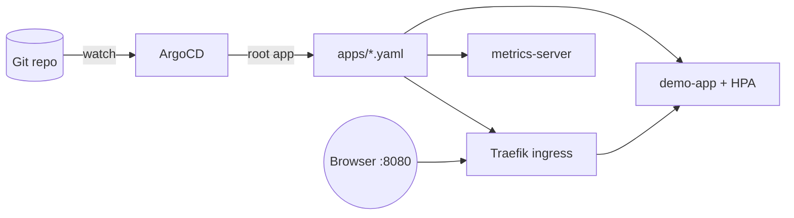

# gitops-platform

A local Kubernetes platform where Git is the single source of truth. One command builds a
kind cluster, installs ArgoCD, and ArgoCD installs everything else from this repo.

## Architecture

## Requirements

kind, kubectl (1.21+ for built-in kustomize), Docker (or a working Podman setup for kind), make.

## Run

1. Forking? Point `repoURL` in `bootstrap/root-app.yaml` and `apps/demo-app.yaml` at your fork.
2. Push the repo to GitHub (public, or add repo credentials to ArgoCD).
3. `make up`
4. Open http://demo.localtest.me:8080
5. ArgoCD UI: `kubectl --context kind-gitops-portfolio -n argocd port-forward svc/argocd-server 8081:80`,
   then http://localhost:8081, user `admin`, password from `make password`.

Tear down: `make down`.

Day-to-day operation, upgrades and troubleshooting: [docs/operations.md](docs/operations.md).

## Design notes

- kind has no LoadBalancer, so host ports 8080/8443 map to Traefik NodePorts 30080/30443.
- The Deployment has no `replicas`; the HPA (2 to 6, 60% CPU) owns scaling, so ArgoCD
  self-heal does not fight it.
- metrics-server runs with `--kubelet-insecure-tls`. Acceptable for a local lab only.
- ArgoCD itself is installed with kustomize from the pinned upstream `install.yaml`
  (`bootstrap/argocd/`), so no local Helm is needed. Chart versions for Traefik and
  metrics-server are pinned in `apps/*.yaml` and rendered by ArgoCD in-cluster.

## Next

cert-manager, kube-prometheus-stack, External Secrets, Kyverno policies.
