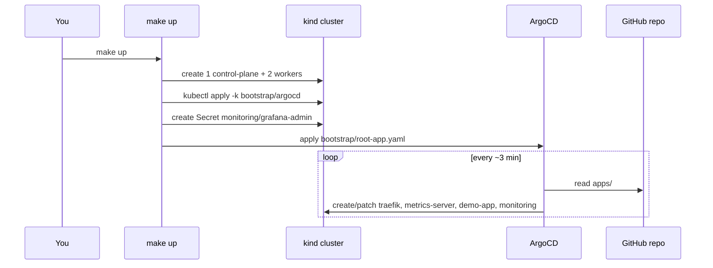

# Operations guide

How this platform works and how to run it day to day. Commands are for the laptop
(fish shell). Every `kubectl` command passes `--context kind-gitops-portfolio` so it can
never hit a real cluster by accident.

## 1. How it works



1. `make cluster` creates the kind cluster from `kind/cluster.yaml`. Host ports
   8080/8443 map to node ports 30080/30443.
2. `make argocd` installs ArgoCD with Kustomize from the pinned upstream `install.yaml`
   (`bootstrap/argocd/`). This is the only part **not** managed by Git sync.
3. `make grafana-secret` creates the Grafana admin login with a random password. It lives
   only in the cluster because the repo is public. Rerunning it keeps the existing password.
4. `make root` applies the `root` Application by hand. It watches `apps/`.
5. ArgoCD creates one child Application per file in `apps/` (app-of-apps), and each child
   deploys its own chart or manifests.

The request path for the demo:
`browser → localhost:8080 → kind node :30080 → Traefik → Ingress demo.localtest.me → Service demo-app → podinfo pods`.
`*.localtest.me` is public DNS that resolves to `127.0.0.1`, so no `/etc/hosts` edit is needed.

## 2. Repo layout

| Path | What it is | How changes reach the cluster |
|---|---|---|
| `kind/cluster.yaml` | Cluster shape and port mappings | `make down && make up` |
| `bootstrap/argocd/` | ArgoCD install (Kustomize, pinned version) | `make argocd` |
| `bootstrap/root-app.yaml` | The root Application | `make root` |
| `apps/*.yaml` | One ArgoCD Application per component | `git push`, ArgoCD syncs |
| `manifests/demo-app/` | Plain YAML for the demo app | `git push`, ArgoCD syncs |

## 3. Daily commands

| Task | Command |
|---|---|
| Build everything | `make up` (about 3 to 5 minutes) |
| Destroy everything | `make down` |
| App status | `kubectl --context kind-gitops-portfolio -n argocd get applications` |
| Test the demo | `curl -sI http://demo.localtest.me:8080` (expect `HTTP/1.1 200 OK`) |
| ArgoCD admin password | `make password` |
| ArgoCD UI | see below |
| Grafana | http://grafana.localtest.me:8080, user `admin`, password from `make grafana-password` |

ArgoCD UI (keep the terminal open while you use it):

```fish
kubectl --context kind-gitops-portfolio -n argocd port-forward svc/argocd-server 8081:80
```

Open http://localhost:8081, user `admin`, password from `make password`.

Healthy state: all five apps (`root`, `traefik`, `metrics-server`, `demo-app`,
`monitoring`) show `Synced` and `Healthy`.

### Monitoring

`apps/monitoring.yaml` deploys kube-prometheus-stack: Prometheus, Grafana,
kube-state-metrics and node-exporter, plus the stock dashboards. Useful dashboards
(Grafana, Dashboards, folder **General**):

| Dashboard | Answers |
|---|---|
| Kubernetes / Compute Resources / Cluster | CPU and memory per namespace |
| Kubernetes / Compute Resources / Namespace (Pods) | Which pod uses what; pick `demo` to watch the HPA scale |
| Node Exporter / Nodes | CPU, memory, disk and network per kind node |
| Kubernetes / Persistent Volumes, Networking | Storage and traffic |

Prometheus UI, for raw queries:

```fish
kubectl --context kind-gitops-portfolio -n monitoring port-forward svc/monitoring-kube-prometheus-prometheus 9090:9090
```

Open http://localhost:9090, then Status, Target health. Every target should be `UP`.

Reset the Grafana password: delete the Secret, recreate it, then restart Grafana.
Grafana keeps no state on disk, so its dashboards come back from the chart.

```fish
kubectl --context kind-gitops-portfolio -n monitoring delete secret grafana-admin
make grafana-secret
kubectl --context kind-gitops-portfolio -n monitoring rollout restart deploy/monitoring-grafana
```

## 4. Changing things (the GitOps way)

Rule: **change Git, not the cluster.** Every app has `selfHeal: true`, so a manual
`kubectl edit`/`apply`/`delete` on a managed resource is reverted within seconds.
`prune: true` means deleting a file from Git deletes the resource from the cluster.

Flow for any change under `apps/` or `manifests/`:

```fish
cd ~/Work/devops-portfolio/gitops-platform
# edit files, then
git add -A
git commit -m "demo-app: ..."
git push
# optional: skip the ~3 min poll
kubectl --context kind-gitops-portfolio -n argocd annotate application root argocd.argoproj.io/refresh=hard --overwrite
```

To refresh one app only, replace `root` with its name, for example `demo-app`.

Examples:

- **New demo version:** change the image tag in `manifests/demo-app/deployment.yaml`.
- **Scaling limits:** change `minReplicas`/`maxReplicas` in `manifests/demo-app/hpa.yaml`.
  Do not add `replicas:` to the Deployment; the HPA owns it and ArgoCD would fight it.
- **Chart settings:** edit `valuesObject` in `apps/traefik.yaml` or `apps/metrics-server.yaml`.

### Add a new component

Create one file in `apps/`, push, and the root app picks it up. Helm chart example:

```yaml
apiVersion: argoproj.io/v1alpha1
kind: Application
metadata:
  name: my-chart
  namespace: argocd
spec:
  project: default
  source:
    repoURL: https://example.github.io/charts
    chart: my-chart
    targetRevision: 1.2.3          # always pin
    helm:
      valuesObject: {}
  destination:
    server: https://kubernetes.default.svc
    namespace: my-chart
  syncPolicy:
    automated: {prune: true, selfHeal: true}
    syncOptions: [CreateNamespace=true]
```

For plain YAML, copy `apps/demo-app.yaml`, point `path:` at a new folder under
`manifests/`, and put the manifests there.

## 5. Upgrades

| Component | Where the version lives | How to upgrade |
|---|---|---|
| ArgoCD | tag in `bootstrap/argocd/kustomization.yaml` | edit, commit, then `make argocd` |
| Traefik | `targetRevision` in `apps/traefik.yaml` | edit, check values (below), push |
| metrics-server | `targetRevision` in `apps/metrics-server.yaml` | edit, check values, push |
| kube-prometheus-stack | `targetRevision` in `apps/monitoring.yaml` | edit, check values, push; read the chart's upgrade notes, major versions often change CRDs |
| podinfo | image tag in `manifests/demo-app/deployment.yaml` | edit, push |

Charts change their values schema between major versions (Traefik 42 moved
`service.type` to `service.spec.type`). Check before pushing, with the values copied
from `valuesObject` into a file:

```fish
helm show values traefik --repo https://traefik.github.io/charts --version <new> | less
helm template traefik traefik --repo https://traefik.github.io/charts --version <new> -f values.yaml >/dev/null; and echo OK
```

Helm is only used here as a local check; ArgoCD renders charts in-cluster.

## 6. Troubleshooting

Start with the app status, then read the error message of the failing app:

```fish
kubectl --context kind-gitops-portfolio -n argocd get applications
kubectl --context kind-gitops-portfolio -n argocd get application <name> \
  -o jsonpath='{range .status.conditions[*]}{.type}: {.message}{"\n"}{end}'
```

| Symptom | Cause | Fix |
|---|---|---|
| `root` is `Unknown`, message `Repository not found` | Repo not pushed, private, or wrong `repoURL` | Push; make repo public; check `repoURL` in `bootstrap/root-app.yaml` and `apps/demo-app.yaml`, then `make root` |
| App `Unknown`, message `values don't meet the specifications of the schema` | Chart values key renamed in this chart version | Fix `valuesObject` (see section 5), push |
| `curl: (56) Connection reset by peer` on :8080 | Traefik not running or not ready yet | `kubectl --context kind-gitops-portfolio -n traefik get pods`; check the `traefik` app error |
| `demo-app` stuck `Progressing`, traffic works | Ingress has no address in `status.loadBalancer` | Already handled by `ingressEndpoint.hostname` in `apps/traefik.yaml`; if it returns, check Traefik logs |
| `404 page not found` from Traefik | Host header does not match | Use `demo.localtest.me`, not `localhost` or a typo |
| HPA shows `cpu: <unknown>` | metrics-server not ready | Wait a minute; check the `metrics-server` app |
| Grafana pod `CreateContainerConfigError` | Secret `grafana-admin` missing (cluster built without `make up`) | `make grafana-secret` |
| Grafana login rejected | Password changed after Grafana first started | Reset steps in section 3, Monitoring |
| `monitoring` sync fails with `metadata.annotations: Too long` | CRDs applied client-side | Keep `ServerSideApply=true` in `apps/monitoring.yaml` |
| Prometheus target `DOWN` | Component not reachable from pods | Check Status, Target health in Prometheus; kind control-plane components are disabled on purpose |
| `make cluster` fails, port already allocated | Something else uses 8080/8443 | `ss -ltnp \| grep -E ':8080\|:8443'`, stop it |
| Cluster dead after reboot | kind node containers did not restart | `docker ps -a \| grep gitops-portfolio`; if stopped, `make down && make up` |

Logs:

```fish
kubectl --context kind-gitops-portfolio -n traefik logs deploy/traefik --tail=50
kubectl --context kind-gitops-portfolio -n argocd logs deploy/argocd-repo-server --tail=50
kubectl --context kind-gitops-portfolio -n argocd logs sts/argocd-application-controller --tail=50
```

`argocd-repo-server` logs show Git and Helm rendering errors; the application controller
logs show sync and health problems.

## 7. Limits (local lab only)

- metrics-server runs with `--kubelet-insecure-tls`.
- No TLS on the demo or Grafana, repo must be public.
- kind binds host ports 8080/8443 on all interfaces, so the demo and Grafana login page
  are reachable from your Wi-Fi network. Grafana is protected only by its random password.
- Monitoring has no Alertmanager and keeps 2 days of metrics; Prometheus is capped at 1 GiB.
- ArgoCD does not manage itself; its upgrades go through `make argocd`.
- Memory: the three kind nodes use about 2.2 GiB together (measured with `docker stats`).
  On a 15 GiB laptop, `make down` when not in use.
